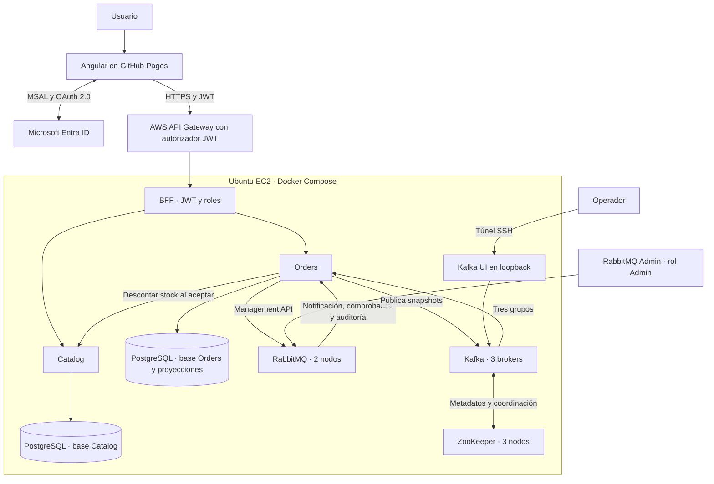
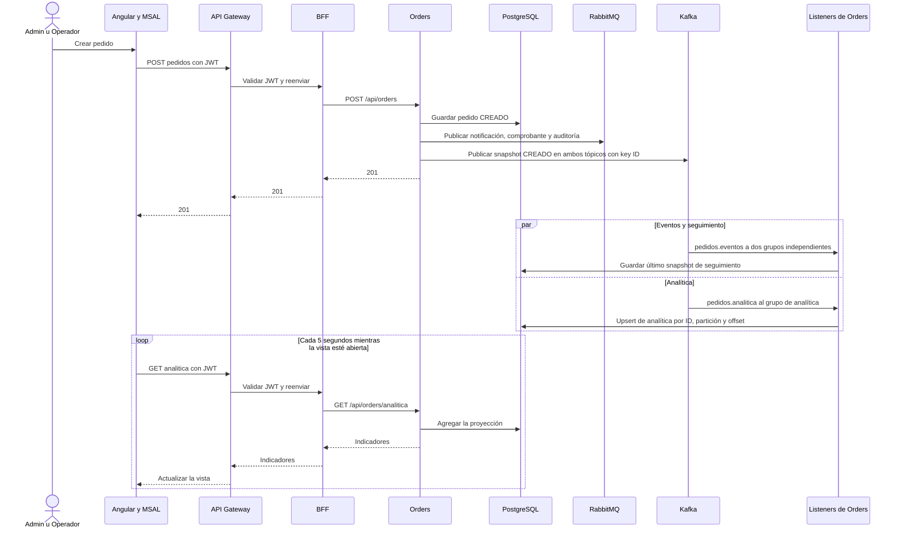
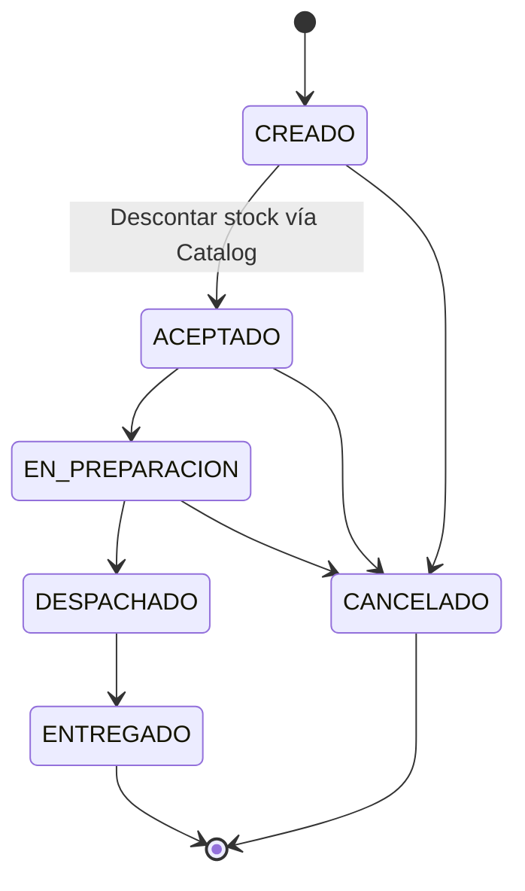

# Pedidos360

Proyecto académico de **Cloud Native I** para gestionar productos y pedidos mediante una aplicación web, servicios REST y mensajería asíncrona.

Su objetivo es integrar autenticación con Microsoft Entra ID, autorización por roles, persistencia en PostgreSQL y procesamiento de eventos con RabbitMQ y Kafka, manteniendo responsabilidades separadas entre la interfaz, el BFF y los servicios de negocio.

> **Alcance EP3:** rama `feature/ep3-kafka-streaming`. La configuración del repositorio se contrastó con el código. El despliegue y las comprobaciones AWS se documentan según lo reportado por el equipo.

## Contenido

1. [Tecnologías y propósito](#1-tecnologías-y-propósito)
2. [Arquitectura general](#2-arquitectura-general)
3. [Estructura del repositorio](#3-estructura-del-repositorio)
4. [Servicios y contratos REST](#4-servicios-y-contratos-rest)
5. [Seguridad](#5-seguridad)
6. [RabbitMQ](#6-rabbitmq)
7. [AWS, contenedores y PostgreSQL](#7-aws-contenedores-y-postgresql)
8. [Flujo de pedidos](#8-flujo-de-pedidos)
9. [Ejecución](#9-ejecución)
10. [Pruebas y verificación](#10-pruebas-y-verificación)
11. [Estado actual y pendientes](#11-estado-actual-y-pendientes)

## 1. Tecnologías y propósito

Las versiones siguientes corresponden a los manifiestos del repositorio, no a una comprobación del entorno instalado.

| Tecnología | Versión declarada | Propósito |
|---|---|---|
| Angular y Angular Router | 21.2.x | Interfaz SPA, formularios y navegación protegida. |
| TypeScript / RxJS | ~5.9.2 / ~7.8.0 | Tipado y manejo de solicitudes asíncronas. |
| MSAL Angular / MSAL Browser | ^6.2.1 / ^5.22.0 | Inicio y cierre de sesión, adquisición e incorporación de access tokens. |
| Microsoft Entra ID / JWT | Configuración OAuth2 | Identidad y credenciales de acceso a las API. |
| Java / Spring Boot | 17 / 4.1.1 | Servicios REST y configuración de aplicaciones. |
| Spring Security / OAuth2 Resource Server | Dependencias de Spring Boot | Validación de JWT y autorización en BFF y RabbitMQ Admin. |
| Spring Data JPA / PostgreSQL | PostgreSQL 16-alpine en Compose | Persistencia de productos y pedidos. |
| Spring AMQP / RabbitMQ | RabbitMQ 4.1-management | Publicación, enrutamiento y consumo de mensajes. |
| Apache Kafka / ZooKeeper | Confluent Platform 7.9.11 | Publicación de snapshots y proyecciones independientes. |
| Kafka UI | v0.7.2 | Inspección de brokers, tópicos, mensajes y grupos. |
| Spring Retry | 2.0.12 en Orders | Hasta tres intentos de procesamiento por mensaje. |
| Maven / Maven Wrapper | POM por servicio | Compilación y pruebas del backend. |
| Docker / Docker Compose | Archivos del repositorio | Imágenes y entornos de infraestructura. |
| AWS API Gateway / EC2 | URL configurada / preparación documentada | Entrada HTTP del frontend y alojamiento Ubuntu del backend. |
| GitHub Actions / Pages | Workflow de frontend | Compilación y publicación configurada de Angular desde `main`. |
| JUnit, MockMvc, Mockito / Vitest | Dependencias de pruebas | Pruebas de backend y frontend; ver alcance en la sección 10. |

## 2. Arquitectura general

El repositorio contiene los componentes y archivos Compose de referencia. La guía EC2 describe el entorno reportado por el equipo y las verificaciones que deben repetirse desde AWS. RabbitMQ Admin es un servicio separado del flujo de pedidos.

## 3. Estructura del repositorio

| Directorio | Componente |
|---|---|
| [frontend](frontend/README.md) | Angular, MSAL y polling de analítica. |
| [ms-pedidos360-bff](ms-pedidos360-bff/README.md) | Proxy REST, JWT, roles y CORS. |
| [ms-pedidos360-catalog](ms-pedidos360-catalog/README.md) | Catálogo y stock. |
| [ms-pedidos360-orders](ms-pedidos360-orders/README.md) | Pedidos, RabbitMQ y Kafka. |
| [ms-pedidos360-rabbitmq-admin](ms-pedidos360-rabbitmq-admin/README.md) | Administración de topología RabbitMQ. |
| [ms-pedidos360-kafka-admin](ms-pedidos360-kafka-admin/README.md) | Administración independiente de tópicos. |
| [infra](infra/aws/README.md) | Compose, configuración y operación. |

La rama es un monorepo con proyectos y manifiestos independientes y sin submódulos Git. Si la pauta exige **repositorios Git separados**, esta estructura solo satisface la separación por módulos. En una tarea posterior, crear un repositorio por unidad exigida, extraer el historial de su carpeta si corresponde y ajustar CI, Docker y referencias cruzadas. Confirmar el criterio con la pauta antes de migrar.

## 4. Servicios y contratos REST

### Catalog

Puerto predeterminado **8082**. Gestiona productos con `id`, `nombre`, `precio` (`BigDecimal`) y `stock`. Valida nombre obligatorio, precio y stock no nulos y no negativos.

Base: `/api/catalog/productos`.

| Método | Ruta relativa | Operación |
|---|---|---|
| GET | Vacía / `/{id}` | Listar / buscar producto. |
| POST | Vacía | Crear producto. |
| PUT | `/{id}` | Actualizar nombre, precio y stock. |
| PATCH | `/{id}/stock?cantidad=N` | Descontar una cantidad positiva si hay stock. |
| DELETE | `/{id}` | Eliminar producto. |

El descuento de stock lo llama Orders directamente; no hay un endpoint equivalente de stock expuesto por el BFF.

### Orders

Puerto predeterminado **8081**. Cada pedido contiene `id`, `productoId`, `cantidad` y `estado`: el modelo actual representa **un producto por pedido**, sin carrito, total ni propietario.

Base: `/api/orders`.

| Método | Ruta relativa | Operación |
|---|---|---|
| GET | Vacía / `/{id}` | Listar / buscar pedido. |
| POST | Vacía | Crear en estado CREADO, publicar en RabbitMQ y emitir a ambos tópicos Kafka; responde 201 si termina correctamente. |
| PUT | `/{id}` | Editar producto y cantidad solo en estado CREADO. |
| PATCH | `/{id}/estado?estado=ACEPTADO` | Cambiar estado validando la transición. |
| DELETE | `/{id}` | Eliminar un pedido existente; responde 204. |
| GET | /analitica | Totales y conteo por estado desde Kafka. |
| GET | /seguimiento/{id} | Último snapshot procesado o 404. |

La creación exige `productoId` no nulo y `cantidad` positiva. No consulta la existencia ni el stock del producto al crear. La actualización también exige un identificador de producto positivo. La eliminación no restringe el estado del pedido.

### BFF

Puerto predeterminado **8080**. Centraliza autenticación y permisos para las operaciones de negocio mediante `SecurityConfig`.

- `/api/bff/catalog` y `/api/bff/catalog/{id}`: GET, POST en la colección, PUT y DELETE por identificador.
- `/api/bff/orders` y `/api/bff/orders/{id}`: GET, POST en la colección, PUT y DELETE por identificador.
- `PATCH /api/bff/orders/{id}/estado?estado=...`: cambio de estado.
- GET /api/bff/orders/analitica y GET /api/bff/orders/seguimiento/{id}: lecturas EP3 para Admin y Operador.

Usa `RestClient` y devuelve las respuestas de los servicios. En errores HTTP conserva estado, cuerpo y tipo de contenido, dejando que Spring genere los encabezados del BFF. Los clientes actuales no propagan el JWT a Catalog ni a Orders.

### RabbitMQ Admin

Puerto **8083**. Administra recursos mediante la API HTTP Management de RabbitMQ; no usa JPA ni forma parte del flujo de creación de pedidos.

Base: `/api/admin/rabbitmq`. Todas las operaciones requieren JWT con rol `Admin`.

| Método | Ruta relativa | Cuerpo / función |
|---|---|---|
| POST | `/queues` | `{"nombre":"prueba.demo"}`: crea una cola durable. |
| DELETE | `/queues/{nombre}` | Elimina solo nombres `prueba.*`, con cola vacía y sin uso. |
| POST | `/exchanges` | `{"nombre":"prueba.direct","tipo":"direct"}`: tipos direct, topic o fanout. |
| DELETE | `/exchanges/{nombre}` | Solo `prueba.*` y con condición `if-unused=true`. |
| POST | `/bindings` | Campos `exchange`, `cola`, `routingKey`: crea un enlace. |
| DELETE | `/bindings` | Mismos campos; exchange y cola deben comenzar con `prueba.`. |

El cliente usa HTTP/1.1 y Basic Auth hacia Management, con credenciales externas, y trabaja sobre el vhost **`/`** codificado como `%2F`. Esto no equivale a soporte configurable del vhost aislado del Compose AWS. RabbitMQ Admin expone operaciones de topología.

## 5. Seguridad

### Identidad y tokens

1. MSAL inicializa la SPA y procesa la respuesta de redirección en `frontend/src/main.ts`.
2. El usuario inicia sesión con Microsoft Entra ID.
3. MSAL solicita el scope de la API `access_as_user`.
4. `MsalInterceptor` incorpora el access token a solicitudes dirigidas al BFF local o al dominio API Gateway configurado.
5. Spring Security en el BFF valida el JWT mediante emisor y audiencia configurados y aplica permisos por rol.

La aplicación no necesita publicar contraseñas, access tokens ni secretos de cliente en el README. Los identificadores de registro y tenant están en la configuración del proyecto; no se reproducen aquí.

El BFF convierte `scp` en autoridades `SCOPE_...` y `roles` en `ROLE_...`. Las reglas de los endpoints documentados exigen roles; la conversión del scope no significa que cada ruta tenga una regla explícita de scope.

### Permisos del BFF

| Operación | Cliente | Operador | Admin |
|---|:---:|:---:|:---:|
| Consultar catálogo | Sí | Sí | Sí |
| Crear, actualizar o eliminar productos | No | No | Sí |
| Crear pedidos | Sí | Sí | Sí |
| Consultar pedidos, editar, cambiar estado o eliminar | No | Sí | Sí |

`MsalGuard` protege dashboard, catálogo y pedidos. La lectura de roles en Angular adapta la interfaz; la autorización efectiva ocurre en el backend. Cliente puede crear pedidos, pero no dispone de “mis pedidos”: el modelo no vincula el pedido con la identidad del usuario.

BFF y RabbitMQ Admin usan sesiones stateless y CSRF desactivado. El BFF configura CORS para el origen local `http://localhost:4200` y el origen GitHub Pages declarado, con métodos GET, POST, PUT, PATCH, DELETE y OPTIONS y encabezados Authorization y Content-Type. RabbitMQ Admin no declara una política CORS equivalente.

RabbitMQ Admin requiere `ENTRA_JWT_ISSUER_URI` y `ENTRA_JWT_AUDIENCE`; no tienen valores predeterminados. Convierte el claim `roles`, exige Admin para su base REST y deniega el resto.

**Límite actual:** Catalog y Orders no incluyen Spring Security ni validación JWT propia. Sus API deben mantenerse en una red controlada; exponerlas directamente permitiría evitar los permisos del BFF. La configuración de seguridad de API Gateway no está definida en este repositorio.

## 6. RabbitMQ

La topología se declara en [RabbitMQConfig.java](ms-pedidos360-orders/src/main/java/cl/duoc/pedidos360/orders/config/RabbitMQConfig.java). Exchanges y colas se declaran durables.

| Exchange | Tipo | Routing key de publicación / binding | Cola | Consumidor |
|---|---|---|---|---|
| `pedidos.direct` | Direct | `pedido.creado` | `pedidos.notificaciones` | `PedidoConsumer` |
| `pedidos.direct` | Direct | `pedido.comprobante` | `pedidos.comprobantes` | `ComprobanteConsumer` |
| `pedidos.topic` | Topic | Publicación `pedido.creado`; binding `pedido.*` | `pedidos.auditoria` | `AuditoriaConsumer` |
| `pedidos.dlx` | Direct | `pedidos.notificaciones.dlq` | `pedidos.notificaciones.dlq` | `DeadLetterConsumer`, opcional |
| `pedidos.dlx` | Direct | `pedidos.comprobantes.dlq` | `pedidos.comprobantes.dlq` | `DeadLetterConsumer`, opcional |
| `pedidos.dlx` | Direct | `pedidos.auditoria.dlq` | `pedidos.auditoria.dlq` | `DeadLetterConsumer`, opcional |

`PedidoProducer` realiza tres publicaciones independientes con un texto que incluye el identificador del pedido. Estas publicaciones AMQP son de texto. Los eventos Kafka usan su propio contrato JSON. El binding Topic recibe claves con un segmento tras `pedido.`, como `pedido.creado`.

### ACK, NACK y DLQ

Los tres consumidores principales usan confirmación manual:

- Intentan procesar el mensaje hasta **tres veces en total** con `RetryTemplate`.
- Si terminan correctamente, envían `basicAck(deliveryTag, false)`.
- Si fallan todos los intentos, envían `basicNack(deliveryTag, false, false)`: rechazan sin reencolar.
- Los argumentos `x-dead-letter-exchange` y `x-dead-letter-routing-key` de cada cola principal dirigen el rechazo hacia su DLQ.
- Un mensaje que contenga `PRUEBA_ERROR` provoca el error simulado en los tres consumidores principales.

El procesamiento de notificaciones, comprobantes y auditoría se limita actualmente a mensajes en consola. No implementa envío de correo, generación de PDF ni almacenamiento de auditoría.

`DeadLetterConsumer` tiene sus tres listeners **desactivados por defecto** mediante `pedidos360.dlq.consumer.enabled=false` (valor predeterminado de la anotación). Si se habilita con `PEDIDOS360_DLQ_CONSUMER_ENABLED=true`, registra el mensaje y envía ACK: lo retira de la cola, sin reintento de negocio ni repositorio histórico.

En el Compose de integración AWS también está desactivado el arranque de los consumidores principales. La declaración de topología y la conexión inicial de Orders pueden ocurrir aunque no se consuman mensajes.

No se declaran en este código políticas TTL o max-length, un mecanismo de replay de DLQ, outbox transaccional ni confirmaciones explícitas del publicador. La durabilidad de la topología no acredita por sí sola entrega garantizada de extremo a extremo.

## 7. AWS, contenedores y PostgreSQL

El entorno EP3 reportado usa una EC2 Ubuntu t3.large con Docker Compose, tres ZooKeeper, tres brokers, Kafka UI por SSH, dos nodos RabbitMQ y bases PostgreSQL independientes para Catalog y Orders. API Gateway tiene las dos rutas nuevas bajo el autorizador JWT existente. La ruta de seguimiento pasa el ID dinámico al BFF. CORS admite GitHub Pages y localhost:4200.

El Compose AWS de referencia es de integración aislada. Incluye un RabbitMQ individual, configura Orders con listeners AMQP deshabilitados y publica el BFF en loopback. El clúster de dos nodos y la configuración de Gateway se operan fuera de ese archivo. Los antecedentes de restauración local siguen en la [guía de integración](infra/aws/README.md). Para el procedimiento AWS y los datos por verificar, consultar [EP3-EC2](infra/aws/EP3-EC2.md).

## 8. Flujo de pedidos

### Creación y actualización de analítica

Las ramas AMQP y Kafka tienen entregas independientes. Los indicadores son eventualmente consistentes y su fuente es la proyección de analítica. Ver [Kafka en Orders](ms-pedidos360-orders/KAFKA.md) para reintentos, offsets y límites.

### Estados y stock

Solo la transición CREADO → ACEPTADO descuenta stock. Cancelar un pedido aceptado no repone existencias. Cada cambio de estado exitoso emite `ESTADO_CAMBIADO` en Kafka. El descuento y el cambio de estado ocurren en servicios distintos, sin compensación distribuida ni protección explícita frente a actualizaciones concurrentes de stock.

## 9. Ejecución

Usar Java 17, Maven, Node 22 y Docker Compose. Cada aplicación se compila en su directorio. El [frontend](frontend/README.md) explica la configuración local y el workflow Pages. El [BFF](ms-pedidos360-bff/README.md) describe las URLs internas. Para Kafka, consultar [el Compose y sus parámetros](infra/kafka/README.md). Para EC2, seguir [el runbook](infra/aws/EP3-EC2.md).

## 10. Pruebas y verificación

En las etapas anteriores se reportaron compilaciones correctas de Orders, BFF y Angular. Las pruebas de BFF simulan el decoder JWT y Orders. Angular simula HTTP y polling. La evidencia de operación en AWS reportada incluye Angular integrado, descarte de JSON inválido y recuperación del lag. Esta revisión documental no repitió esas pruebas.

Los comandos, resultados esperados y evidencias a mostrar están en [DEMO-EP3](DEMO-EP3.md). Para reproducir las suites, usar Maven por componente y npm en frontend. Las integraciones PostgreSQL deben apuntar a una base de pruebas aislada.

## 11. Estado actual y pendientes

Registrar evidencia de la defensa sin credenciales. La caída de brokers y los reintentos recuperables siguen sin validación en AWS. Las proyecciones dependen de eventos publicados y retenidos. El borrado físico carece de evento Kafka y puede dejar el último snapshot. Los tres brokers comparten la misma EC2.

Mantener fuera de Git secretos, JWT, respaldos, exportaciones Docker y artefactos. Separar repositorios únicamente si la pauta exige repositorios Git independientes.
