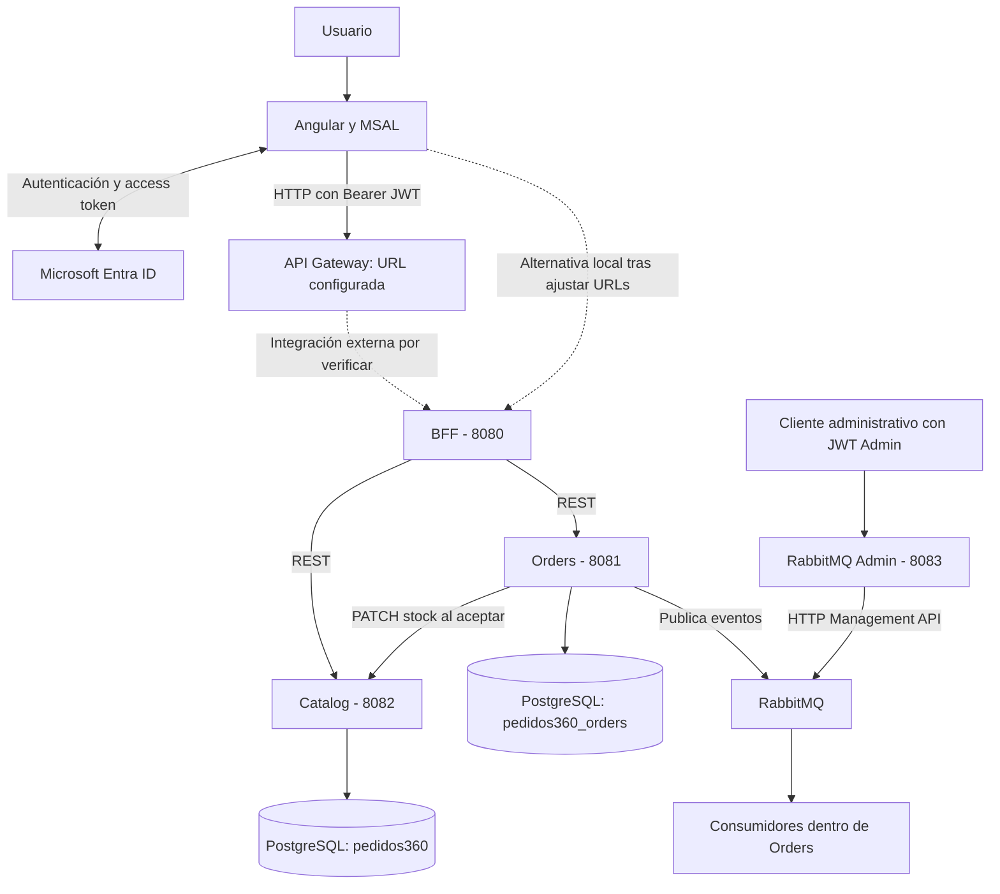
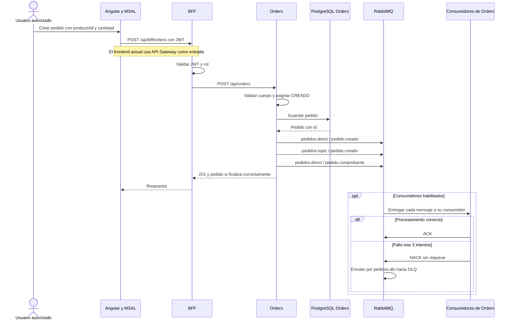
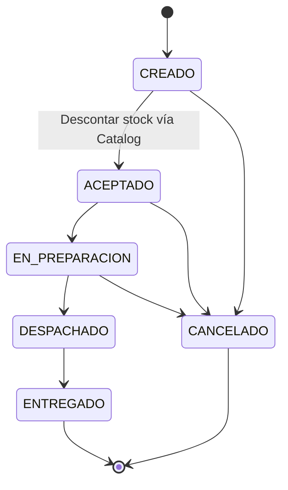

# Pedidos360

Proyecto académico de **Cloud Native I** para gestionar productos y pedidos mediante una aplicación web, servicios REST y mensajería asíncrona.

Su objetivo es integrar autenticación con Microsoft Entra ID, autorización por roles, persistencia en PostgreSQL y procesamiento de eventos con RabbitMQ, manteniendo responsabilidades separadas entre la interfaz, el BFF y los servicios de negocio.

> **Alcance:** documentación del código y la configuración disponibles en el checkout de `main`. “Implementado” significa que existe código; “configurado” significa que existe una declaración de configuración; “probado” requiere evidencia de ejecución. Esta revisión es estática: no se ejecutaron aplicaciones, pruebas ni despliegues. No se atribuyen a `main` funcionalidades exclusivas de `feature/monitor-rabbitmq`.

## Contenido

1. [Tecnologías y propósito](#1-tecnologías-y-propósito)
2. [Arquitectura general](#2-arquitectura-general)
3. [Estructura del repositorio](#3-estructura-del-repositorio)
4. [Servicios y contratos REST](#4-servicios-y-contratos-rest)
5. [Seguridad](#5-seguridad)
6. [RabbitMQ](#6-rabbitmq)
7. [AWS, contenedores y PostgreSQL](#7-aws-contenedores-y-postgresql)
8. [Flujo de pedidos](#8-flujo-de-pedidos)
9. [Ejecución](#9-ejecución)
10. [Pruebas y verificación](#10-pruebas-y-verificación)
11. [Estado actual y pendientes](#11-estado-actual-y-pendientes)

## 1. Tecnologías y propósito

Las versiones siguientes corresponden a los manifiestos del repositorio, no a una comprobación del entorno instalado.

| Tecnología | Versión declarada | Propósito |
|---|---|---|
| Angular y Angular Router | 21.2.x | Interfaz SPA, formularios y navegación protegida. |
| TypeScript / RxJS | ~5.9.2 / ~7.8.0 | Tipado y manejo de solicitudes asíncronas. |
| MSAL Angular / MSAL Browser | ^6.2.1 / ^5.22.0 | Inicio y cierre de sesión, adquisición e incorporación de access tokens. |
| Microsoft Entra ID / JWT | Configuración OAuth2 | Identidad y credenciales de acceso a las API. |
| Java / Spring Boot | 17 / 4.1.1 | Servicios REST y configuración de aplicaciones. |
| Spring Security / OAuth2 Resource Server | Dependencias de Spring Boot | Validación de JWT y autorización en BFF y RabbitMQ Admin. |
| Spring Data JPA / PostgreSQL | PostgreSQL 16-alpine en Compose | Persistencia de productos y pedidos. |
| Spring AMQP / RabbitMQ | RabbitMQ 4.1-management | Publicación, enrutamiento y consumo de mensajes. |
| Spring Retry | 2.0.12 en Orders | Hasta tres intentos de procesamiento por mensaje. |
| Maven / Maven Wrapper | POM por servicio | Compilación y pruebas del backend. |
| Docker / Docker Compose | Archivos del repositorio | Imágenes y entornos de infraestructura. |
| AWS API Gateway / EC2 | URL configurada / preparación documentada | Entrada HTTP prevista y destino de alojamiento del backend. |
| GitHub Actions / Pages | Workflow de frontend | Compilación y publicación configurada de Angular desde `main`. |
| JUnit, MockMvc, Mockito / Vitest | Dependencias de pruebas | Pruebas de backend y frontend; ver alcance en la sección 10. |

## 2. Arquitectura general

El frontend utiliza el BFF como entrada a las operaciones de catálogo y pedidos. El BFF realiza llamadas HTTP síncronas a los servicios. Orders consulta Catalog para descontar stock al aceptar un pedido y publica mensajes de creación en RabbitMQ.



La línea discontinua hacia el BFF no acredita una integración AWS activa. La URL de API Gateway está en Angular; no hay una definición de infraestructura que permita reconstruir sus rutas, integración o autorizadores. RabbitMQ Admin tiene una API independiente: el BFF y las rutas Angular revisadas no lo integran.

## 3. Estructura del repositorio

```text
Pedidos360/
├── README.md
├── .github/
│   └── workflows/deploy-pages.yml      # Build y publicación de Angular
├── frontend/
│   ├── src/
│   │   ├── main.ts                     # Inicialización de MSAL y Angular
│   │   └── app/
│   │       ├── app.config.ts           # HTTP, MSAL, scopes y recursos protegidos
│   │       ├── app.routes.ts           # Login y rutas con MsalGuard
│   │       └── pages/
│   │           ├── login/             # Inicio de sesión
│   │           ├── dashboard/         # Cuenta, rol y cierre de sesión
│   │           ├── catalog/           # Consulta y CRUD según rol
│   │           └── orders/            # Creación, consulta y cambio de estado
│   ├── public/                        # Recursos estáticos
│   ├── angular.json
│   ├── package.json
│   └── package-lock.json
├── ms-pedidos360-catalog/
│   ├── src/main/java/cl/duoc/pedidos360/
│   │   ├── controller/
│   │   ├── service/
│   │   ├── repository/
│   │   └── entity/
│   ├── src/main/resources/application.properties
│   ├── src/test/
│   ├── .mvn/ y mvnw / mvnw.cmd
│   ├── pom.xml
│   └── Dockerfile
├── ms-pedidos360-orders/
│   ├── src/main/java/cl/duoc/pedidos360/orders/
│   │   ├── controller/
│   │   ├── service/
│   │   ├── repository/
│   │   ├── entity/
│   │   ├── client/                    # Cliente HTTP de Catalog
│   │   ├── config/                    # Topología RabbitMQ
│   │   └── messaging/                 # Productor y consumidores
│   ├── src/main/resources/application.properties
│   ├── src/test/
│   ├── .mvn/ y mvnw / mvnw.cmd
│   ├── pom.xml
│   └── Dockerfile
├── ms-pedidos360-bff/
│   ├── src/main/java/cl/duoc/pedidos360/bff/
│   │   ├── controller/
│   │   ├── client/                    # Clientes HTTP Catalog y Orders
│   │   └── config/                    # JWT, roles y CORS
│   ├── src/main/resources/application.properties
│   ├── src/test/
│   ├── .mvn/ y mvnw / mvnw.cmd
│   └── pom.xml
├── ms-pedidos360-rabbitmq-admin/
│   ├── src/main/java/cl/duoc/rabbitmqadmin/
│   │   ├── controller/
│   │   ├── service/                   # Cliente HTTP de RabbitMQ Management
│   │   └── config/                    # Seguridad JWT y rol Admin
│   ├── src/main/resources/application.properties
│   ├── src/test/                      # Pruebas de seguridad MVC
│   └── pom.xml
├── infra/
│   ├── rabbitmq/docker-compose.yml    # Broker local con puertos publicados
│   └── aws/
│       ├── compose.yaml               # Integración aislada, preparación EC2
│       ├── .env.example               # Nombres de variables, claves vacías
│       ├── README.md                  # Procedimientos y restricciones operativas
│       └── postgres/init/
│           └── 01-create-orders-db.sh
├── docs/                              # Reservado; contiene .gitkeep
└── backend/                           # Solo target local en el árbol revisado
```

En los servicios, `controller` define HTTP, `service` implementa reglas de negocio, `repository` accede a datos y `entity` define el modelo persistente. Los directorios `target/` y `node_modules/` son artefactos locales, no componentes de la arquitectura. No hay un POM agregador en la raíz.

## 4. Servicios y contratos REST

### Catalog

Puerto predeterminado **8082**. Gestiona productos con `id`, `nombre`, `precio` (`BigDecimal`) y `stock`. Valida nombre obligatorio, precio y stock no nulos y no negativos.

Base: `/api/catalog/productos`.

| Método | Ruta relativa | Operación |
|---|---|---|
| GET | Vacía / `/{id}` | Listar / buscar producto. |
| POST | Vacía | Crear producto. |
| PUT | `/{id}` | Actualizar nombre, precio y stock. |
| PATCH | `/{id}/stock?cantidad=N` | Descontar una cantidad positiva si hay stock. |
| DELETE | `/{id}` | Eliminar producto. |

El descuento de stock lo llama Orders directamente; no hay un endpoint equivalente de stock expuesto por el BFF.

### Orders

Puerto predeterminado **8081**. Cada pedido contiene `id`, `productoId`, `cantidad` y `estado`: el modelo actual representa **un producto por pedido**, sin carrito, total ni propietario.

Base: `/api/orders`.

| Método | Ruta relativa | Operación |
|---|---|---|
| GET | Vacía / `/{id}` | Listar / buscar pedido. |
| POST | Vacía | Crear en estado CREADO y publicar tres mensajes; responde 201 si termina correctamente. |
| PUT | `/{id}` | Editar producto y cantidad solo en estado CREADO. |
| PATCH | `/{id}/estado?estado=ACEPTADO` | Cambiar estado validando la transición. |
| DELETE | `/{id}` | Eliminar un pedido existente; responde 204. |

La creación exige `productoId` no nulo y `cantidad` positiva. No consulta la existencia ni el stock del producto al crear. La actualización también exige un identificador de producto positivo. La eliminación no restringe el estado del pedido.

### BFF

Puerto predeterminado **8080**. Centraliza autenticación y permisos para las operaciones de negocio mediante `SecurityConfig`.

- `/api/bff/catalog` y `/api/bff/catalog/{id}`: GET, POST en la colección, PUT y DELETE por identificador.
- `/api/bff/orders` y `/api/bff/orders/{id}`: GET, POST en la colección, PUT y DELETE por identificador.
- `PATCH /api/bff/orders/{id}/estado?estado=...`: cambio de estado.

Usa `RestClient` y devuelve las respuestas de los servicios. En errores HTTP conserva estado, cuerpo y tipo de contenido, dejando que Spring genere los encabezados del BFF. Los clientes actuales no propagan el JWT a Catalog ni a Orders.

### RabbitMQ Admin

Puerto **8083**. Administra recursos mediante la API HTTP Management de RabbitMQ; no usa JPA ni forma parte del flujo de creación de pedidos.

Base: `/api/admin/rabbitmq`. Todas las operaciones requieren JWT con rol `Admin`.

| Método | Ruta relativa | Cuerpo / función |
|---|---|---|
| POST | `/queues` | `{"nombre":"prueba.demo"}`: crea una cola durable. |
| DELETE | `/queues/{nombre}` | Elimina solo nombres `prueba.*`, con cola vacía y sin uso. |
| POST | `/exchanges` | `{"nombre":"prueba.direct","tipo":"direct"}`: tipos direct, topic o fanout. |
| DELETE | `/exchanges/{nombre}` | Solo `prueba.*` y con condición `if-unused=true`. |
| POST | `/bindings` | Campos `exchange`, `cola`, `routingKey`: crea un enlace. |
| DELETE | `/bindings` | Mismos campos; exchange y cola deben comenzar con `prueba.`. |

El cliente usa HTTP/1.1 y Basic Auth hacia Management, con credenciales externas, y trabaja sobre el vhost **`/`** codificado como `%2F`. Esto no equivale a soporte configurable del vhost aislado del Compose AWS. No hay endpoints de lectura de métricas ni un panel de monitoreo RabbitMQ en las rutas Angular de `main`.

## 5. Seguridad

### Identidad y tokens

1. MSAL inicializa la SPA y procesa la respuesta de redirección en `frontend/src/main.ts`.
2. El usuario inicia sesión con Microsoft Entra ID.
3. MSAL solicita el scope de la API `access_as_user`.
4. `MsalInterceptor` incorpora el access token a solicitudes dirigidas al BFF local o al dominio API Gateway configurado.
5. Spring Security en el BFF valida el JWT mediante emisor y audiencia configurados y aplica permisos por rol.

La aplicación no necesita publicar contraseñas, access tokens ni secretos de cliente en el README. Los identificadores de registro y tenant están en la configuración del proyecto; no se reproducen aquí.

El BFF convierte `scp` en autoridades `SCOPE_...` y `roles` en `ROLE_...`. Las reglas de los endpoints documentados exigen roles; la conversión del scope no significa que cada ruta tenga una regla explícita de scope.

### Permisos del BFF

| Operación | Cliente | Operador | Admin |
|---|:---:|:---:|:---:|
| Consultar catálogo | Sí | Sí | Sí |
| Crear, actualizar o eliminar productos | No | No | Sí |
| Crear pedidos | Sí | Sí | Sí |
| Consultar pedidos, editar, cambiar estado o eliminar | No | Sí | Sí |

`MsalGuard` protege dashboard, catálogo y pedidos. La lectura de roles en Angular adapta la interfaz; la autorización efectiva ocurre en el backend. Cliente puede crear pedidos, pero no dispone de “mis pedidos”: el modelo no vincula el pedido con la identidad del usuario.

BFF y RabbitMQ Admin usan sesiones stateless y CSRF desactivado. El BFF configura CORS para el origen local `http://localhost:4200` y el origen GitHub Pages declarado, con métodos GET, POST, PUT, PATCH, DELETE y OPTIONS y encabezados Authorization y Content-Type. RabbitMQ Admin no declara una política CORS equivalente.

RabbitMQ Admin requiere `ENTRA_JWT_ISSUER_URI` y `ENTRA_JWT_AUDIENCE`; no tienen valores predeterminados. Convierte el claim `roles`, exige Admin para su base REST y deniega el resto.

**Límite actual:** Catalog y Orders no incluyen Spring Security ni validación JWT propia. Sus API deben mantenerse en una red controlada; exponerlas directamente permitiría evitar los permisos del BFF. La configuración de seguridad de API Gateway no está definida en este repositorio.

## 6. RabbitMQ

La topología se declara en [RabbitMQConfig.java](ms-pedidos360-orders/src/main/java/cl/duoc/pedidos360/orders/config/RabbitMQConfig.java). Exchanges y colas se declaran durables.

| Exchange | Tipo | Routing key de publicación / binding | Cola | Consumidor |
|---|---|---|---|---|
| `pedidos.direct` | Direct | `pedido.creado` | `pedidos.notificaciones` | `PedidoConsumer` |
| `pedidos.direct` | Direct | `pedido.comprobante` | `pedidos.comprobantes` | `ComprobanteConsumer` |
| `pedidos.topic` | Topic | Publicación `pedido.creado`; binding `pedido.*` | `pedidos.auditoria` | `AuditoriaConsumer` |
| `pedidos.dlx` | Direct | `pedidos.notificaciones.dlq` | `pedidos.notificaciones.dlq` | `DeadLetterConsumer`, opcional |
| `pedidos.dlx` | Direct | `pedidos.comprobantes.dlq` | `pedidos.comprobantes.dlq` | `DeadLetterConsumer`, opcional |
| `pedidos.dlx` | Direct | `pedidos.auditoria.dlq` | `pedidos.auditoria.dlq` | `DeadLetterConsumer`, opcional |

`PedidoProducer` realiza tres publicaciones independientes con un texto que incluye el identificador del pedido. No existe un contrato JSON de evento. El binding Topic recibe claves con un segmento tras `pedido.`, como `pedido.creado`.

### ACK, NACK y DLQ

Los tres consumidores principales usan confirmación manual:

- Intentan procesar el mensaje hasta **tres veces en total** con `RetryTemplate`.
- Si terminan correctamente, envían `basicAck(deliveryTag, false)`.
- Si fallan todos los intentos, envían `basicNack(deliveryTag, false, false)`: rechazan sin reencolar.
- Los argumentos `x-dead-letter-exchange` y `x-dead-letter-routing-key` de cada cola principal dirigen el rechazo hacia su DLQ.
- Un mensaje que contenga `PRUEBA_ERROR` provoca el error simulado en los tres consumidores principales.

El procesamiento de notificaciones, comprobantes y auditoría se limita actualmente a mensajes en consola. No implementa envío de correo, generación de PDF ni almacenamiento de auditoría.

`DeadLetterConsumer` existe en `main`, pero sus tres listeners están **desactivados por defecto** mediante `pedidos360.dlq.consumer.enabled=false` (valor predeterminado de la anotación). Si se habilita con `PEDIDOS360_DLQ_CONSUMER_ENABLED=true`, registra el mensaje y envía ACK: lo retira de la cola, sin reintento de negocio ni repositorio histórico.

En el Compose de integración AWS también está desactivado el arranque de los consumidores principales. La declaración de topología y la conexión inicial de Orders pueden ocurrir aunque no se consuman mensajes.

No se declaran en este código políticas TTL o max-length, un mecanismo de replay de DLQ, outbox transaccional ni confirmaciones explícitas del publicador. La durabilidad de la topología no acredita por sí sola entrega garantizada de extremo a extremo.

## 7. AWS, contenedores y PostgreSQL

### API Gateway y EC2

Angular tiene configurado un endpoint API Gateway de `us-east-1` para catálogo y pedidos. Esto demuestra una referencia de configuración; no demuestra disponibilidad actual, rutas desplegadas ni conectividad al BFF.

[infra/aws/README.md](infra/aws/README.md) describe preparación para EC2 y una integración local aislada. No hay Terraform, CloudFormation ni automatización de aprovisionamiento EC2/API Gateway en los archivos revisados. No se acredita un despliegue AWS completo.

### Dos entornos Compose diferentes

| Aspecto | Broker local | Integración y preparación EC2 |
|---|---|---|
| Archivo | `infra/rabbitmq/docker-compose.yml` | `infra/aws/compose.yaml` |
| Servicios | RabbitMQ | PostgreSQL, Catalog, Orders y RabbitMQ independiente |
| Puertos publicados | 5672 y 15672 | Ninguno |
| Redes | Red de Compose | `datos` y `aplicacion`, ambas internas |
| Datos | Volumen `rabbitmq_data` | Volúmenes `postgres_data` y `rabbitmq_integration_data` |
| Consumidores | Según aplicación Orders ejecutada aparte | Principales y DLQ detenidos por configuración |
| BFF y RabbitMQ Admin | No incluidos | No incluidos |

El Compose AWS tiene nombre fijo `pedidos360-aws`. Catalog y Orders requieren imágenes locales con `pull_policy: never`; no tienen un bloque `build`. Sus Dockerfiles son multietapa, compilan con Maven omitiendo pruebas y ejecutan con JRE 17 y un usuario sin privilegios. No hay Dockerfile para BFF ni RabbitMQ Admin.

Los healthchecks comprueban disponibilidad de PostgreSQL, ejecución de RabbitMQ y apertura TCP de Catalog/Orders. No constituyen pruebas funcionales completas. Catalog y Orders tienen límites de 512 MiB y 0,50 CPU cada uno; RabbitMQ, 768 MiB y 0,50 CPU, con watermark de 400 MiB y plazo de apagado de 60 segundos. Son parámetros configurados, no capacidad validada para una instancia EC2.

### PostgreSQL

- Catalog utiliza `pedidos360`; Orders utiliza `pedidos360_orders`.
- En ejecución local, las propiedades usan `localhost:5432` y `ddl-auto=update`.
- En Compose AWS se usa `ddl-auto=validate`, SQL init desactivado para las aplicaciones y roles separados `pedidos360_catalog_app` / `pedidos360_orders_app`.
- El script de inicialización crea la segunda base solo cuando PostgreSQL inicializa un directorio de datos vacío. No crea los roles limitados ni restaura tablas o datos.
- El perfil `integracion-test` se selecciona en Compose; no hay un archivo de propiedades específico de ese perfil en el código revisado.
- Las redes internas no proporcionan una solución completa para un futuro BFF que necesite comunicarse con Entra ID.

La guía de infraestructura registra restauraciones y verificaciones locales anteriores, incluido un conteo histórico de productos y pedidos y observaciones del broker. Son antecedentes documentados, no mediciones repetidas en esta revisión ni evidencia de despliegue en AWS. El arranque completo de las imágenes de aplicación queda señalado como pendiente en esa guía.

## 8. Flujo de pedidos

### Creación



El guardado ocurre antes de publicar. No hay una transacción distribuida ni outbox que una PostgreSQL y RabbitMQ: un fallo de publicación puede dejar el pedido persistido aunque la solicitud termine con error, o producir publicaciones parciales.

### Estados y stock



Solo la transición CREADO → ACEPTADO descuenta stock. Cancelar un pedido aceptado no repone existencias. No se publican eventos de cambio de estado en el productor actual. El descuento y el cambio de estado ocurren en servicios distintos, sin compensación distribuida ni protección explícita frente a actualizaciones concurrentes de stock.

## 9. Ejecución

Los comandos son instrucciones para el operador; **no fueron ejecutados durante esta actualización**. Se parte de la raíz del repositorio, salvo indicación contraria.

### Requisitos

- JDK 17 y acceso a las dependencias Maven.
- Maven instalado para RabbitMQ Admin, que no incluye Wrapper; los otros tres servicios sí lo incluyen.
- Node.js 22 y npm como referencia del workflow; dependencias fijadas por `frontend/package-lock.json`.
- Docker con Compose para levantar el broker local o preparar imágenes.
- PostgreSQL accesible, con las dos bases y permisos apropiados.
- Registros Entra ID para SPA/API, redirect URI local y/o Pages, scope y roles asignados. La configuración externa debe coincidir con la del frontend y los validadores JWT.

### Variables de configuración

Proporcionar contraseñas por un mecanismo seguro de entorno del proceso. No incluir valores reales en comandos compartidos, capturas o logs.

| Servicio / entorno | Variables |
|---|---|
| Catalog y Orders | `SPRING_DATASOURCE_URL`, `SPRING_DATASOURCE_USERNAME`, `SPRING_DATASOURCE_PASSWORD`; opcionalmente `PORT`. Cada servicio recibe su propia base. |
| Orders | `CATALOG_SERVICE_URL`, `RABBITMQ_HOST`, `RABBITMQ_PORT`, `RABBITMQ_USERNAME`, `RABBITMQ_PASSWORD`; `SPRING_RABBITMQ_VIRTUAL_HOST` si corresponde. |
| BFF | `CATALOG_SERVICE_URL`, `ORDERS_SERVICE_URL`, `PORT`; emisor y audiencia actualmente definidos en sus propiedades, sobreescribibles mediante `SPRING_SECURITY_OAUTH2_RESOURCESERVER_JWT_ISSUER_URI` y `SPRING_SECURITY_OAUTH2_RESOURCESERVER_JWT_AUDIENCES`. |
| RabbitMQ Admin | `RABBITMQ_MANAGEMENT_URL`, `RABBITMQ_MANAGEMENT_USERNAME`, `RABBITMQ_PASSWORD`, `ENTRA_JWT_ISSUER_URI`, `ENTRA_JWT_AUDIENCE`. Puerto 8083 definido en propiedades. |
| Compose AWS | `POSTGRES_USER`, `POSTGRES_PASSWORD`, `CATALOG_DB_PASSWORD`, `ORDERS_DB_PASSWORD`, `INTEGRATION_RABBITMQ_USER`, `INTEGRATION_RABBITMQ_PASSWORD`, `INTEGRATION_RABBITMQ_VHOST`. |

Los valores predeterminados de contraseña están vacíos. BFF usa por defecto Orders en `localhost:8081` y Catalog en `localhost:8082`; Orders también apunta a Catalog local. RabbitMQ Admin apunta por defecto a Management en `localhost:15672`.

### Backend local

Preparar las bases `pedidos360` y `pedidos360_orders` y sus credenciales antes de iniciar las aplicaciones. El Compose de broker local no levanta PostgreSQL.

Con `RABBITMQ_PASSWORD` disponible en el entorno:

```powershell
docker compose -f infra/rabbitmq/docker-compose.yml up -d
```

En terminales independientes, entrar al directorio indicado y ejecutar:

| Directorio | Comando PowerShell |
|---|---|
| `ms-pedidos360-catalog` | `.\mvnw.cmd spring-boot:run` |
| `ms-pedidos360-orders` | `.\mvnw.cmd spring-boot:run` |
| `ms-pedidos360-bff` | `.\mvnw.cmd spring-boot:run` |
| `ms-pedidos360-rabbitmq-admin` | `mvn spring-boot:run` |

En Linux/macOS, usar `./mvnw` en lugar de `.\mvnw.cmd`. Iniciar PostgreSQL y RabbitMQ antes de Orders, y Catalog antes de probar la aceptación de pedidos. Orders intenta abrir una conexión RabbitMQ durante el arranque.

Management estará publicado en `http://localhost:15672` para el Compose local. RabbitMQ Admin es opcional para el flujo de negocio y requiere su configuración Entra independiente.

### Frontend

```powershell
cd frontend
npm ci
npm start
```

Abrir `http://localhost:4200`. **Ejecutar Angular localmente no cambia sus destinos HTTP**: `catalogUrl` y `ordersUrl` apuntan explícitamente a API Gateway en los componentes. Para un recorrido totalmente local hay que adaptar esas URL al BFF en `http://localhost:8080/api/bff/...`; esa modificación no forma parte de esta actualización del README. El interceptor ya contempla el BFF local.

La redirect URI usada localmente parte del origen del navegador; fuera de localhost agrega `/Pedidos360/`. Debe estar registrada en Entra ID. La URL de API no se configura hoy mediante archivos `environment.ts`.

### Imágenes e integración preparada para EC2

Desde la raíz, para construir las dos imágenes existentes:

```powershell
docker build -t pedidos360-catalog:local ./ms-pedidos360-catalog
docker build -t pedidos360-orders:local ./ms-pedidos360-orders
docker compose -f infra/aws/compose.yaml config --no-interpolate --quiet
```

La compilación Docker **omite pruebas**. El último comando valida configuración sin crear recursos ni mostrar secretos interpolados; no comprueba credenciales o conectividad.

Para el inicio del Compose aislado, seguir el procedimiento y requisitos de [infra/aws/README.md](infra/aws/README.md). No es un arranque autónomo desde cero: requiere bases con esquema compatible, roles y contraseñas existentes e imágenes locales. No publica las API al host ni incluye BFF/frontend/Admin, y mantiene cero consumidores por configuración.

La guía exige autorización separada para iniciar o recrear ese entorno y preservar sus datos. No reutilizar el broker original, sus volúmenes ni sus credenciales en el entorno aislado. No ejecutar `down -v`, restauraciones sobre bases pobladas ni limpiezas de volúmenes.

### Publicación del frontend

`.github/workflows/deploy-pages.yml` configura Node 22, `npm ci`, build con `--base-href /Pedidos360/`, copia de `index.html` a `404.html` y publicación en Pages en push a `main` o ejecución manual. El workflow no ejecuta pruebas ni despliega el backend. Su existencia no demuestra que la última publicación haya terminado correctamente.

## 10. Pruebas y verificación

### Pruebas presentes en el código

| Componente | Evidencia | Alcance y límites |
|---|---|---|
| Catalog | `Pedidos360ApplicationTests.contextLoads` | Carga del contexto; requiere configuración de base accesible. No cubre CRUD ni concurrencia. |
| Orders | `MsPedidos360OrdersApplicationTests.contextLoads` | Carga del contexto; depende de PostgreSQL y conexión inicial RabbitMQ. No valida el flujo distribuido. |
| BFF | `MsPedidos360BffApplicationTests.contextLoads` | Carga del contexto con configuración JWT. No verifica la matriz de roles de negocio. |
| RabbitMQ Admin | `SecurityConfigTest` | Tres pruebas MVC con OPTIONS: sin token → 401, Operador → 403, Admin → 200. Decoder y servicio simulados; no prueban firmas reales ni operaciones Management. |
| Angular | `app.spec.ts` | Prueba de creación y prueba de un título de plantilla inicial. Esta última espera un `h1` que ya no está en `app.html`; requiere revisión y no acredita cobertura funcional. |

No se ejecutaron estas suites durante la revisión documental. La presencia de `target/` u otros artefactos no se toma como evidencia de resultados vigentes.

Para ejecutarlas, con configuración de prueba apropiada y desde cada directorio:

```powershell
# Catalog, Orders o BFF, cada uno desde su propia carpeta
.\mvnw.cmd test

# RabbitMQ Admin, desde su carpeta
mvn test

# Frontend, desde frontend/
npm test -- --watch=false
npm run build
```

Los tests de contexto no deben apuntar a datos productivos: las propiedades locales de JPA usan `update` y Orders abre una conexión al broker. Usar bases y broker de prueba aislados.

### Comprobaciones manuales propuestas, no ejecutadas

En un entorno de prueba con JWT válido, verificar mediante el BFF:

1. Sin JWT: acceso rechazado; con rol insuficiente: 403.
2. Admin crea un producto; los tres roles pueden consultar el catálogo.
3. Crear un pedido con `{"productoId":1,"cantidad":2}`, usando un producto realmente existente en ese entorno.
4. Admin u Operador aceptan el pedido y verifican el descuento de stock.
5. Una cantidad superior al stock impide aceptar; una transición inválida devuelve error.
6. Con consumidores activos, verificar las tres entregas, logs y ACK.
7. Publicar manualmente un texto `PRUEBA_ERROR` en el broker de prueba usando los exchanges y routing keys de la sección 6; verificar tres intentos, NACK y mensaje en la DLQ correspondiente.
8. Mantener consumidores DLQ desactivados para inspeccionar mensajes; si se habilitan, comprobar que registran y confirman el mensaje, retirándolo de la cola.

El POST normal de pedidos no genera `PRUEBA_ERROR`. Estas comprobaciones requieren preparar los datos y permisos y registrar resultados; no son pruebas aprobadas por el solo hecho de estar descritas.

## 11. Estado actual y pendientes

| Área | Implementado en main | Configurado / pendiente de validar |
|---|---|---|
| Interfaz | Login, dashboard, catálogo con CRUD Admin, creación de pedidos y gestión de estados para operadores/administradores. | Integración completa con Entra y API Gateway a verificar en ejecución. |
| Catálogo | CRUD, validaciones y descuento de stock. | Concurrencia de stock y manejo uniforme de errores. |
| Pedidos | CRUD, reglas de edición y transiciones; descuento al aceptar. | Propietario y “mis pedidos”, múltiples productos y compensación de stock al cancelar. |
| BFF | Proxy REST, JWT, roles y CORS. | Pruebas de autorización de todas las rutas y protección de la red interna. |
| RabbitMQ | Direct, Topic, tres colas principales y tres DLQ; productor, reintentos, ACK/NACK y consumidor DLQ opcional. | Pruebas de integración reproducibles, idempotencia, confirmaciones del publicador y consistencia con PostgreSQL. |
| Notificaciones y comprobantes | Consumidores con logs y simulación de error. | Correo, comprobantes reales y auditoría persistente. |
| RabbitMQ Admin | Creación y eliminación controlada de recursos, JWT Admin y tests MVC. | Pruebas reales contra Management; integración con frontend/BFF y soporte de vhost configurable. |
| Monitoreo RabbitMQ | No hay pantalla ni API de métricas en los archivos revisados. | No documentar funciones de `feature/monitor-rabbitmq` como disponibles en `main`. |
| Contenedores | Dockerfiles de Catalog/Orders y dos configuraciones Compose. | Arranque integral de aplicaciones, medición de recursos y empaquetado de BFF/Admin. |
| AWS | URL API Gateway en Angular y preparación de infraestructura para EC2. | Aprovisionamiento reproducible, conectividad, seguridad perimetral y despliegue completo acreditado. |
| CI/CD | Workflow de compilación/publicación de Angular. | Pruebas automáticas en CI y despliegue del backend. |

**Evidencia de pruebas:** hay pruebas escritas y antecedentes operativos en la documentación de infraestructura. Esta revisión no confirma ejecución satisfactoria de suites, pruebas de carga ni un despliegue productivo.

Para profundizar, consultar los [procedimientos de infraestructura](infra/aws/README.md), la [configuración de seguridad del BFF](ms-pedidos360-bff/src/main/java/cl/duoc/pedidos360/bff/config/SecurityConfig.java) y la [topología RabbitMQ](ms-pedidos360-orders/src/main/java/cl/duoc/pedidos360/orders/config/RabbitMQConfig.java).

